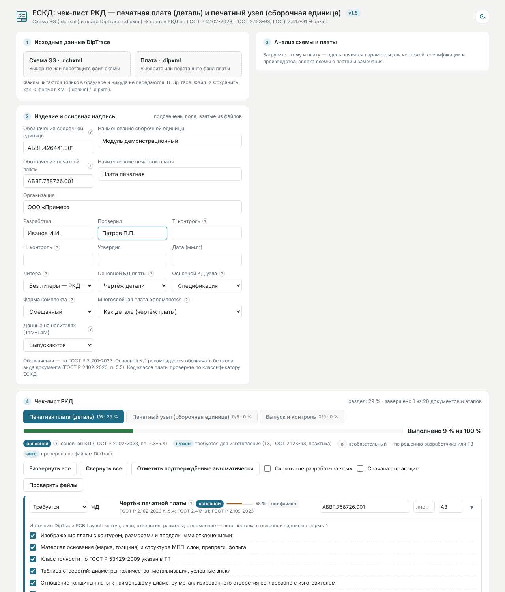

# Чек-лист РКД печатной платы и печатного узла (DipTrace XML)

Автономная HTML-страница для подготовки рабочей конструкторской документации (РКД) на печатную плату (деталь) и печатный узел (сборочную единицу) по ГОСТ Р 2.102-2023, ГОСТ 2.123-93 и ГОСТ 2.417-91. Читает схему и плату DipTrace в формате XML, проверяет их, формирует документы по формам ЕСКД, ведёт чек-лист и строит отчёт о составе комплекта.



## Быстрый старт

1. Откройте `index.html` в браузере — локально или через GitHub Pages. Установка и сервер не нужны.
2. В DipTrace сохраните схему и плату в XML: *Файл → Сохранить как* → `.dchxml` / `.dipxml`.
3. Перетащите оба файла на страницу. Обозначение, наименование и подписи заполнятся из основной надписи схемы.
4. Пройдите чек-лист, сформируйте документы и отчёт.

Файлы проекта обрабатываются только в браузере и никуда не передаются.

## Возможности

- **Анализ схемы и платы**: число элементов с учётом повторяющихся функциональных групп, сверка схемы с платой (реперные знаки исключаются), слои и структура, класс точности по ГОСТ Р 53429, переходные и монтажные отверстия, реперные знаки, посадочные места без 3D-моделей (генерация по IPC-7351 и по контуру считается моделью).
- **Чек-лист РКД** по разделам «Плата», «Узел», «Выпуск и контроль»: статусы, обозначения, листы, форматы, пункты проверки с автоматической проверкой по файлам, сроки, прогресс по каждому пункту.
- **Подсказки**: знак «?» у названий документов и терминов; справочник терминов с поиском.
- **Генераторы документов** (PDF по формам ГОСТ Р 2.104-2023 и ГОСТ Р 2.106-2019, CSV):
  ВП, ВИ, ТБ координат установки (и CSV для автомата), ТБ координат отверстий, ВН, ВЭД, ЛРИ; тексты технических требований чертежа платы и сборочного чертежа; данные габаритного чертежа; шаблоны ПМ, И, РР, ТУ, УЧ для Word.
- **Ссылки на файлы документов**: Gerber, PDF-копии по ЕСКД, подлинники, рабочие файлы. Хранятся только ссылки; содержимое читается при упаковке, поэтому всегда берётся текущая версия.
- **Структура папок проекта**: создание на диске, ZIP-архив, скрипты `.bat` / `.sh`; полный ZIP-пакет с документами и прикреплёнными файлами, разложенными по местам.
- **Отчёты**: состав РКД (HTML, PDF через печать, CSV), список незавершённого и отсутствующих файлов.
- **Ход выполнения**: график готовности от первой записи до сегодняшнего дня, плановая линия, прогноз, календарь сроков.
- **Конфигурация**: сохранение и загрузка `.json`, автосохранение копий `auto_…`, сброс с резервной копией.

## Браузеры

| Функция | Chrome, Edge | Firefox, Safari |
|---|---|---|
| Анализ, чек-лист, генераторы, отчёты, ZIP | да | да |
| Запись структуры и документов прямо на диск | да | нет — используйте ZIP или скрипт |
| Прикрепление файлов через окно выбора | да | только путь внутри папки проекта |

## Шрифт PDF

Документы ЕСКД оформляются шрифтом по ГОСТ 2.304 (тип Б). Распространённый TTF «GOST type B» принадлежит АО «АСКОН» и **в репозиторий не входит**. Варианты:

- **По умолчанию** PDF формируются свободным шрифтом DejaVu Sans Condensed (`vendor/`).
- **Подключить свой TTF**: раздел «Генерация документов» → «Подключить TTF…». Шрифт сохраняется в этом браузере и дальше используется для всех PDF.
- **Локальная сборка со встроенным шрифтом**: положите `GOST_B.ttf` в `fonts/` и выполните `python build.py` — появится `dist/rkd_pcb_checklist_v<версия>_gost.html`. Этот файл только для личного использования, не публикуйте его.

## Сборка

Страница собирается в один файл из исходников:

```
python build.py          # index.html и dist/rkd_pcb_checklist_v<версия>.html
python build.py --check  # проверить, что index.html соответствует исходникам
```

Нужен только Python 3.8+ без дополнительных пакетов. Правки вносятся в `src/app.html`, затем выполняется сборка, и `index.html` коммитится вместе с исходником. GitHub Actions проверяет это при каждом push.

## Структура репозитория

```
index.html            собранная страница (GitHub Pages)
src/app.html          исходник: разметка, стили, логика
vendor/               jsPDF 2.5.2 (MIT), DejaVu Sans Condensed (свободная лицензия)
fonts/                место для локального шрифта ГОСТ (не хранится в репозитории)
build.py              сборка
docs/screenshot.png
CHANGELOG.md          история версий
```

## Версии

Номер версии задаётся константой `APP_VER` в `src/app.html` и показывается в заголовке страницы, отчётах, README папки проекта, свойствах PDF и файле конфигурации. При выпуске версии:

1. обновите `APP_VER`, `APP_DATE` и `APP_LOG` в `src/app.html` и `CHANGELOG.md`;
2. выполните `python build.py` и закоммитьте изменения;
3. поставьте тег `vX.Y` и приложите `dist/rkd_pcb_checklist_vX.Y.html` к релизу.

## GitHub Pages

*Settings → Pages → Deploy from a branch → `main` / `(root)`*. Страница будет доступна по адресу `https://<пользователь>.github.io/<репозиторий>/`.

## Ограничения

Отметки обязательности документов ориентируются на пп. 5.3–5.4 ГОСТ Р 2.102-2023; отметка «нужен» означает «требуется для изготовления на стороннем производстве» и не является требованием стандарта. Ширины граф ведомостей подобраны по форме 5 ГОСТ Р 2.106-2019 и формам предприятия; сверьте их со своим стандартом предприятия. Сверяйтесь с официальными текстами стандартов.

## Лицензия

Код — MIT, см. [LICENSE](LICENSE). Сторонние компоненты: jsPDF — MIT; DejaVu Sans Condensed — лицензия Bitstream Vera / DejaVu (`vendor/LICENSE-DejaVu.txt`).
